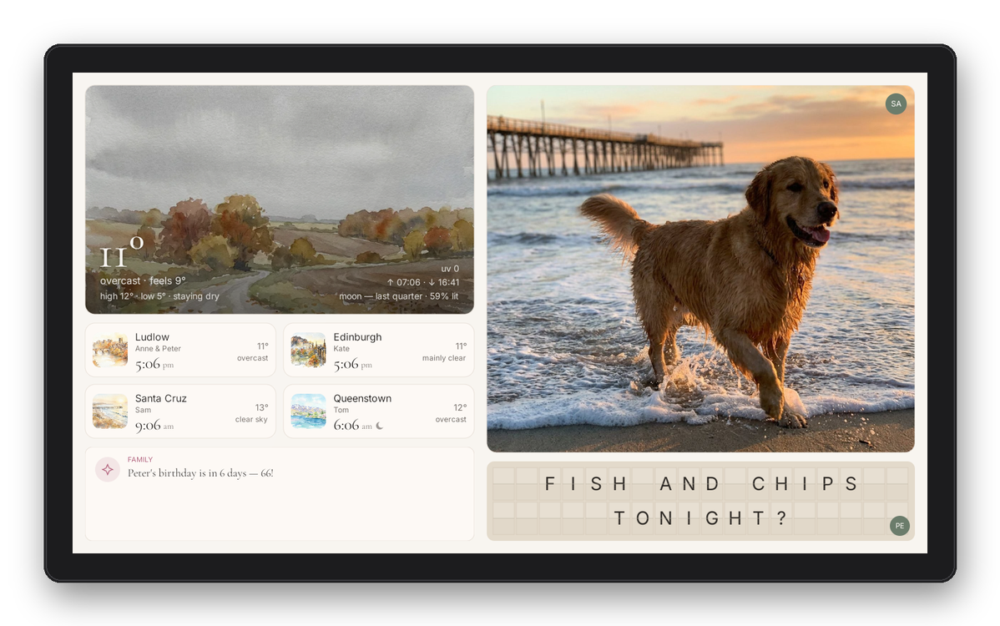
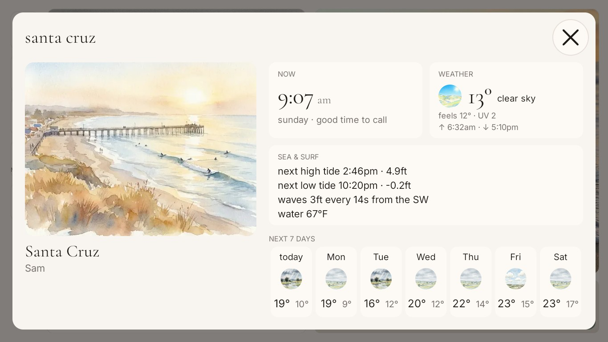
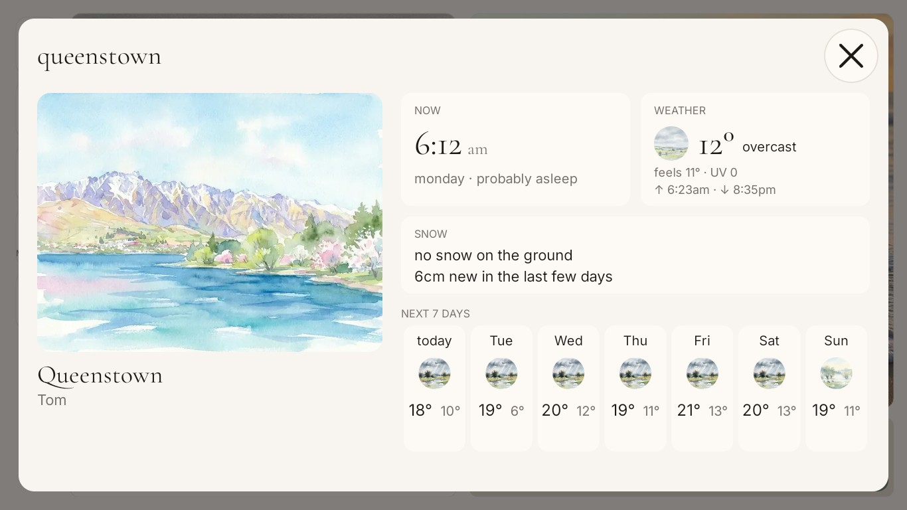
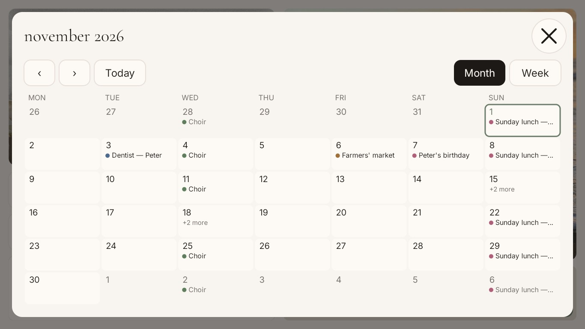
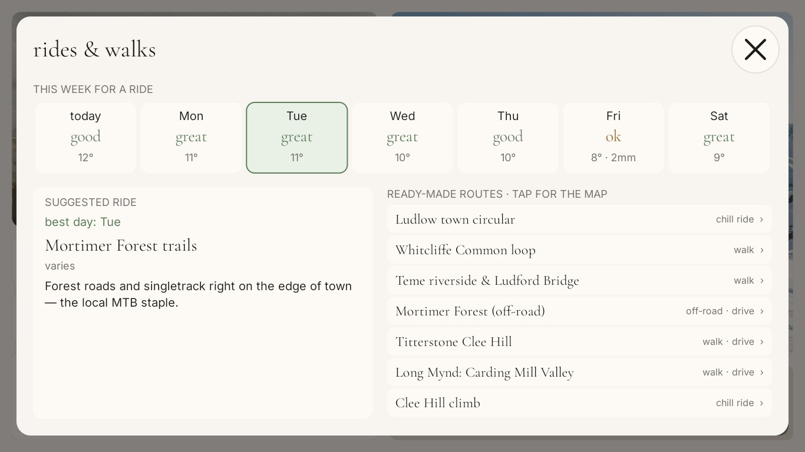
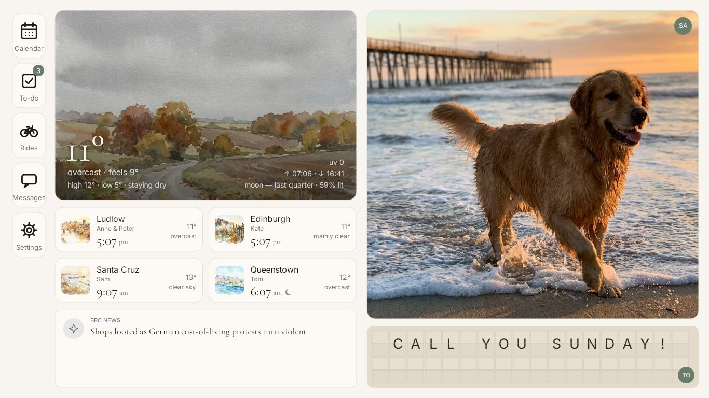
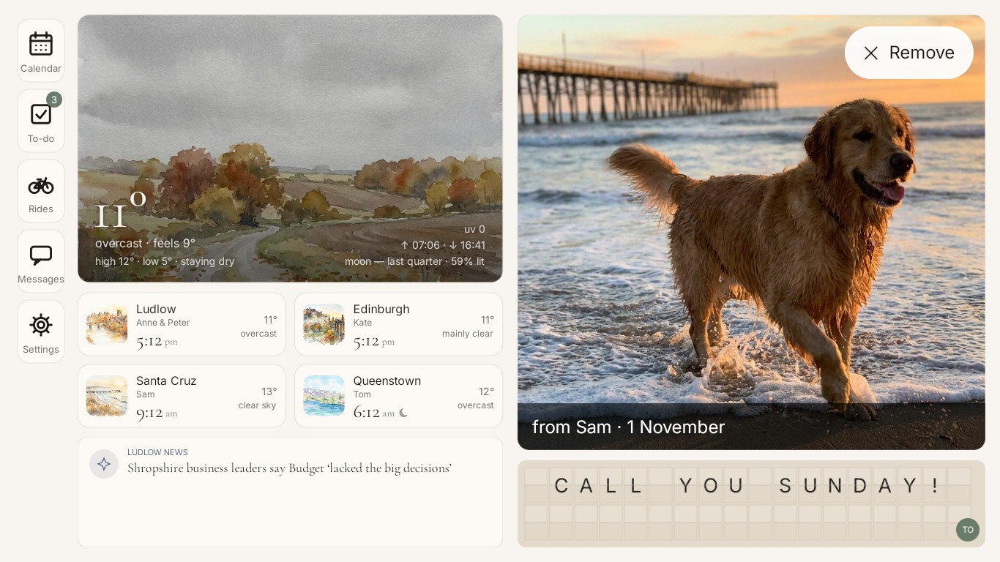
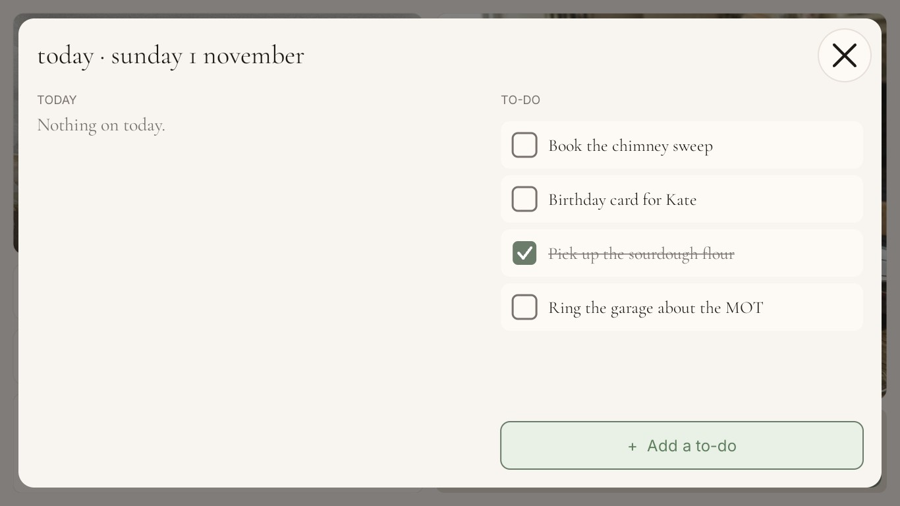
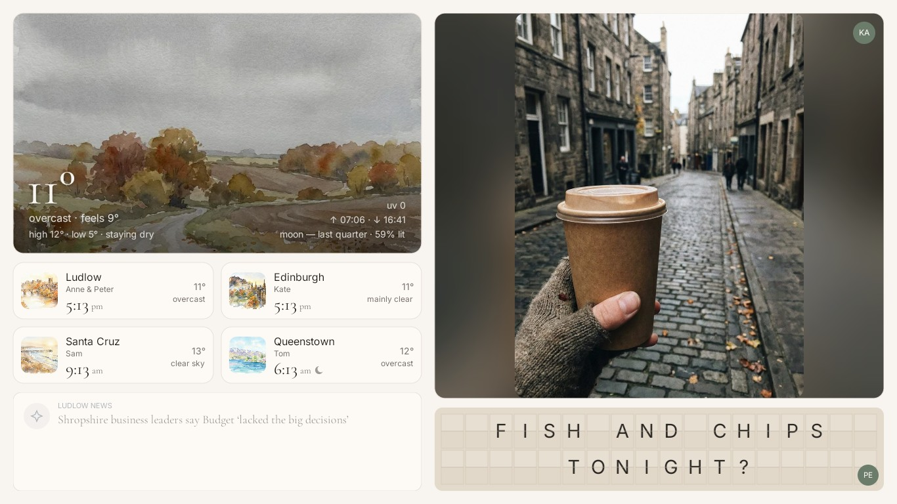
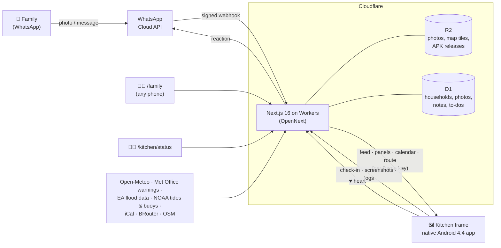

<div align="center">

# cottage view

**A cheap Amazon photo frame, rooted and taught to be a family kitchen display.**

My family is spread across four time zones. This is the thing on my parents' kitchen wall
that keeps us in one place: the local weather as a watercolour, everyone's clocks, the
family calendar, a to-do list, and photos and messages we send to it **over WhatsApp**.
They show up on the wall within seconds.



<sub>The real frame app, drawing a made-up demo family (more on that below). It's a native Android app I wrote for a device that can't run a modern browser.</sub>

</div>

---

## The hack

I ordered a 15.6″ "1080p Frameo" Wi-Fi photo frame. What arrived was something else.

| What the listing said | What `adb` said |
|---|---|
| Frameo | A white-label **VPhoto** app (`com.waophoto.smartframe`) |
| 1920×1080 | Renders at **1366×768** |
| Modern Android | **Android 4.4.2 KitKat** (2013), an `eng` build signed with `test-keys` |
| — | **Allwinner A33**: 4× Cortex-A7, Mali-400, 1 GB RAM |
| — | **ADB open over Wi-Fi, unauthenticated, as root** (`ro.adb.secure=0`, `uid=0`). Anyone on the network gets a root shell. |
| — | An Adups FOTA updater (the one caught sending phone data to China in 2016) |

The good news: root out of the box, so no exploits and no flashing. The bad news:
the web dashboard I'd built (`/kitchen`, Next.js 16 + Tailwind v4) needs Chrome 111+ for
`color-mix()`, `oklch()` and cascade layers. This frame's WebView is **Chromium 30**, can't
be upgraded on KitKat, and the newest Chrome that will install is 95, which throws away
every Tailwind v4 rule inside `@layer`. The page doesn't render badly. It doesn't render.

So I stopped trying to get a browser onto it and **wrote the kitchen as a native app**
that draws everything itself.

### How the frame was taken over

```
 ┌──────────────── the frame, Android 4.4.2 ─────────────────┐
 │                                                            │
 │   VPhoto (stock app)   ── pm disable ──▶  asleep            │
 │                                          (pm enable undoes) │
 │                                                            │
 │   com.cottageview.kitchen  ◀── HOME launcher, boots into it │
 │     ├─ Canvas UI, hand-drawn at 1366×768, ~57 fps          │
 │     ├─ Conscrypt 2.5.3  ─▶ TLS 1.3 on a 2013 OS            │
 │     ├─ root via its own adbd on 127.0.0.1:5555             │
 │     │     ├─ installs its own updates (rolls back crashes) │
 │     │     ├─ screenshots / logs on request                 │
 │     │     └─ iptables: adb only from loopback now          │
 │     └─ polls the Worker: feed every few min, "new?" / 10 s │
 └────────────────────────────────────────────────────────────┘
```

- **A native app with no Gradle.** `android/build.sh` is `javac → d8 --min-api 19 → aapt2 → zipalign → apksigner`
  (with a v1 signature, which KitKat requires). Around 6,000 lines of plain Java, no
  AndroidX, no WebView. The whole APK is **2.3 MB**, most of it the TLS library.
- **Drawing it by hand.** A full redraw of the kitchen cost 57 ms on the A33, so each animated
  part (the split-flap board, the photo crossfade, the notice card) is its own view, the
  static layout sits in a GPU layer, and the flap faces are pre-drawn. The median frame went
  from **102 ms to 17 ms**.
- **HTTPS on a 2013 OS.** KitKat's TLS stack offers TLS 1.0 and CBC ciphers. Vercel,
  Open-Meteo and every Let's Encrypt host refuse it, and ISRG Root X1 isn't in its trust store.
  Bundling **Conscrypt** as the app's TLS provider, plus a bundled ISRG root, gets **TLS 1.3
  (ChaCha20-Poly1305)** to every host.
- **The stock app fights back.** VPhoto drags itself back to the front ~18 seconds after
  anything else opens. It's now `pm disable`d (reversible), and the kitchen app is the HOME
  launcher. If anything else ever takes the screen, the kitchen takes it back within 3 minutes.
- **Root without `su`.** The frame's `su` refuses apps, but its adbd runs as root. So the app
  talks the ADB protocol to itself on `127.0.0.1:5555` to install updates, take screenshots
  and read logs.
- **Closing the door behind me.** Out of the box, anyone on the home Wi-Fi had a root
  shell. The app now drops TCP 5555 from everything except loopback (`iptables … ! -i lo -j DROP`)
  on every start. A remote `openadb` command lifts that for 30 minutes if I ever need it.
- **No Back or Home buttons.** The frame has no buttons at all, so Android's own Wi-Fi settings
  were a dead end the first time someone opened them. The app has its own Wi-Fi screen and an
  on-screen keyboard. If a join fails, it puts the old network back.

## Running it from afar

The frame was set up at my place, then posted to my parents. After that, nobody there can be
asked to plug in a cable. Everything goes through the website, and the frame only ever
calls out (there are no open ports to reach it on).

- **Self-updating.** Bump `android/version.properties`, run `scripts/release-frame-app.mjs`,
  and the frame installs the new version within a day, or at its next 10-minute check-in if I
  press **update**. A release that crash-loops is **rolled back by the frame itself**. That was
  tested on purpose with a build designed to crash on start: back on the previous version in about 5 seconds.
- **`/kitchen/status`.** Shows last seen, version, Wi-Fi strength and errors, with buttons for **screenshot / logs / reload /
  restart / update / openadb** and **"show me a panel"** (the frame opens that panel, screenshots it and closes it again).
- **Wi-Fi preloaded before shipping.** It arrived, joined their network by itself, and has
  been on the wall since.

## What's on the wall

<table>
<tr>
<td width="50%"><br><sub><b>A family clock, tapped.</b> Their time ("good time to call" or "probably asleep"), weather and week, plus live tides and surf for the beach town.</sub></td>
<td width="50%"><br><sub><b>…or the snow,</b> read from the nearest ski field. Paintings follow each place's own seasons, so the southern hemisphere is in spring.</sub></td>
</tr>
<tr>
<td><br><sub><b>Calendar.</b> Google and Apple calendars plus the household's own reminders, in Month and Week views.</sub></td>
<td><br><sub><b>Rides &amp; walks.</b> Which day is best for a ride this week, and local routes drawn on OpenStreetMap tiles with length and climb.</sub></td>
</tr>
<tr>
<td><br><sub><b>The sidebar.</b> A tap anywhere slides it out (pushing the kitchen along, not covering it), and it tucks itself away after 10 seconds.</sub></td>
<td><br><sub><b>Tap a photo</b> to see who sent it. With WhatsApp connected, you can also <b>♥ send a heart</b> back to them, or remove it.</sub></td>
</tr>
<tr>
<td><br><sub><b>To-do.</b> The same list as the family web page, with the app's own big keyboard for adding to it.</sub></td>
<td><br><sub><b>Photos fit themselves:</b> landscape fills, portrait stays whole over a blur. Swipe for the next one.</sub></td>
</tr>
</table>

Also: a "did you know" card that rotates local facts, birthdays and headlines; a weather panel with
the next 18 hours and the week; and a dim night mode from midnight to 6 am.

### About these screenshots

The real frame shows my real family, so these come from the **exact same APK** running in an Android
emulator at the frame's 1366×768 / 160 dpi. It's pointed at this repo running locally with a made-up
family: Anne & Peter in Ludlow, Kate in Edinburgh, Sam in Santa Cruz and Tom in Queenstown. The
weather, tides, surf and snow are live. The photos are AI-generated. `npm run seed:demo` gives you the same family.

## How it fits together



- **Web app**: Next.js 16 (App Router), React 19, TypeScript and Tailwind v4, deployed to
  Cloudflare Workers with `@opennextjs/cloudflare`. It's also a full site for laptops and phones:
  weather, a map with OS Maps and CyclOSM layers, river levels, local news, trains and what's on.
- **Households**: each frame belongs to a household with its own photos, messages, settings,
  PIN and WhatsApp number, so another frame for another branch of the family is one script away
  (`scripts/household.mjs`, `scripts/provision-frame.sh`).
- **`/family`**: where the people with the frame look after it from their phones. They can see every
  photo and who sent it, add to-dos, reminders and calendars, choose what shows on the frame, and empty the bin.
- **Watercolours**: generated once and committed as static `.webp` files (`scripts/generate-watercolors.mjs`).
  The deployed app makes no model calls.
- **Tests**: 946 web tests (Vitest) and 207 JVM tests for the frame app's logic.

## Repo map

```
app/            Next.js routes: /, /kitchen, /family, /kitchen/status, /api/*
lib/            weather, calendars, frame store (D1/KV), households, WhatsApp, ops
android/        the frame app: plain Java, built by build.sh (no Gradle)
  src/main/java/com/cottageview/kitchen/{app,core,ui}
scripts/        release-frame-app, household, provision-frame, seed-demo, watercolours
migrations/     D1 schema
docs/           kitchen-frame.md (the full build log), DEPLOY.md, whatsapp-setup.md
public/         watercolor/ (the painting set), demo/ (the demo family's photos)
```

## Run it

```bash
npm install
npm run dev          # http://localhost:3000  (/kitchen for the wall view)
npm run seed:demo    # fill local dev storage with the demo family
npm test             # vitest
npm run deploy       # build + deploy to Cloudflare Workers

android/build.sh     # debug APK → android/build/kitchen-debug.apk
android/test.sh      # frame app unit tests
```

The site runs with no environment variables at all. Each secret only switches on an extra
(PIN gate, WhatsApp, calendars, OS Maps). See [`docs/DEPLOY.md`](docs/DEPLOY.md) and
[`docs/whatsapp-setup.md`](docs/whatsapp-setup.md). To point the app at your own server, push
`files/server.json` (`{"baseUrl": "https://…"}`) and `files/frame_key` into its data folder over adb.
`scripts/provision-frame.sh` does that for you.

**Want to try this on your own frame?** The full, dated log of the takeover, including the
adb survey, every dead end and an undo step for each change, is in
[`docs/kitchen-frame.md`](docs/kitchen-frame.md). Only point it at a device you own.

## Thanks

[Wes Bos's photo-frame-dashboard](https://github.com/wesbos/photo-frame-dashboard) write-up on
rooting a BIUFRAME was the map for this. His frame ran Android 6. This one needed a different route.
